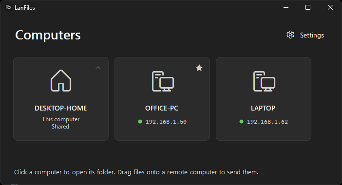

# LanFiles

File sharing between Windows PCs on a local network.

Download `LanFiles.exe` from [Releases](https://github.com/idLorem/LanFiles/releases). To build from source, run `build.bat`.

## Features

- **Finds computers automatically.** Every PC running LanFiles on the same network shows up in the list. You can also add a computer by its IP address.
- **Send files by drag and drop.** Drop files or folders onto a computer card, or use "Send to computer" in the Explorer context menu.
- **Browse shared folders.** Open another computer's shared folder, download files and folders, send new ones, rename items or move them to the Recycle Bin.
- **Password protection.** Each computer has its own password. After several wrong attempts the sender is blocked for 10 minutes.
- **Ask before receiving.** You decide whether to accept incoming files. Starred computers send without asking.
- **Progress and speed.** A small window shows the progress and transfer speed. A transfer can be canceled from either side, and the window can be hidden.
- **Safe transfers.** Files are written to a temporary file first, so a broken transfer leaves no half-written files. The free space on the receiving computer is checked before sending.
- **Runs in the tray** and can start with Windows.
- **Updates itself** from GitHub releases.
- **English and Russian** interface.

## Описание на русском

Обмен файлами между компьютерами с Windows в локальной сети.

Скачайте `LanFiles.exe` в разделе [Releases](https://github.com/idLorem/LanFiles/releases). Чтобы собрать из исходников, запустите `build.bat`.

- **Сам находит компьютеры.** Все компьютеры с LanFiles в той же сети появляются в списке. Компьютер можно добавить и вручную по IP-адресу.
- **Отправка перетаскиванием.** Перетащите файлы или папки на карточку компьютера или выберите «Отправить на компьютер» в контекстном меню Проводника.
- **Просмотр общих папок.** Можно открыть общую папку другого компьютера, скачать файлы и папки, отправить новые, переименовать или удалить в корзину.
- **Защита паролем.** У каждого компьютера свой пароль. После нескольких неверных попыток отправитель блокируется на 10 минут.
- **Подтверждение приёма.** Вы сами решаете, принимать ли входящие файлы. Компьютеры из избранного (со звёздочкой) отправляют без вопроса.
- **Прогресс и скорость.** Небольшое окно показывает прогресс и скорость передачи. Передачу можно отменить с любой стороны, а окно можно скрыть.
- **Надёжная передача.** Файл сначала пишется во временный, поэтому оборванная передача не оставляет недописанных файлов. Перед отправкой проверяется свободное место на компьютере получателя.
- **Работает в трее** и может запускаться вместе с Windows.
- **Обновляется сам** из релизов на GitHub.
- **Интерфейс на английском и русском.**
