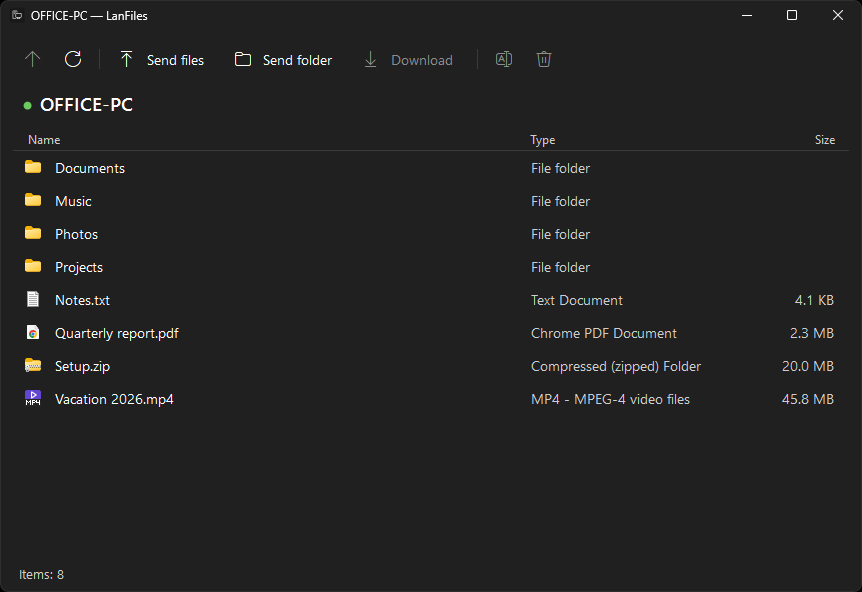

# LanFiles

File sharing between Windows PCs on a local network.

Download `LanFiles.exe` from [Releases](https://github.com/idLorem/LanFiles/releases). To build from source, run `build.bat`.

## Features

- Finds computers automatically.
- Send files by drag and drop.
- Browse shared folders.
- Password protection.
- Ask before receiving.
- Progress and speed.
- Safe transfers.
- Runs in the tray and can start with Windows.
- Updates itself from GitHub releases.
- English and Russian interface.

## Описание на русском

Обмен файлами между компьютерами с Windows в локальной сети.

Скачайте `LanFiles.exe` в разделе [Releases](https://github.com/idLorem/LanFiles/releases). Чтобы собрать из исходников, запустите `build.bat`.

- Сам находит компьютеры.
- Отправка перетаскиванием.
- Просмотр общих папок.
- Защита паролем.
- Подтверждение приёма.
- Прогресс и скорость.
- Надёжная передача.
- Работает в трее и может запускаться вместе с Windows.
- Обновляется сам из релизов на GitHub.
- Интерфейс на английском и русском.
