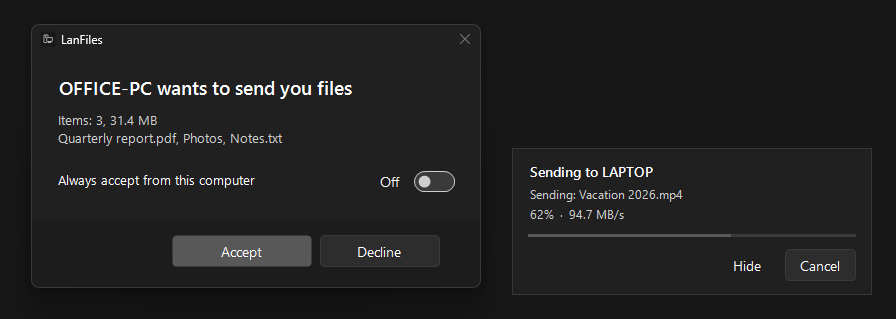
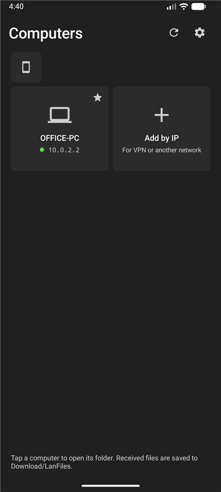
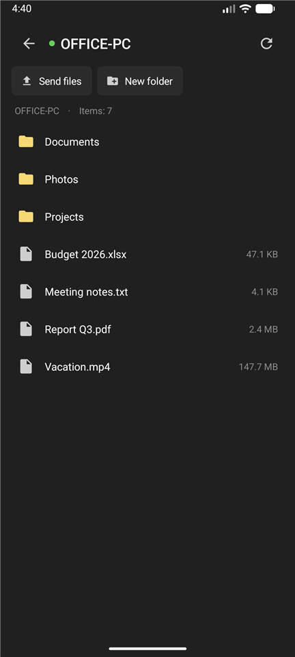
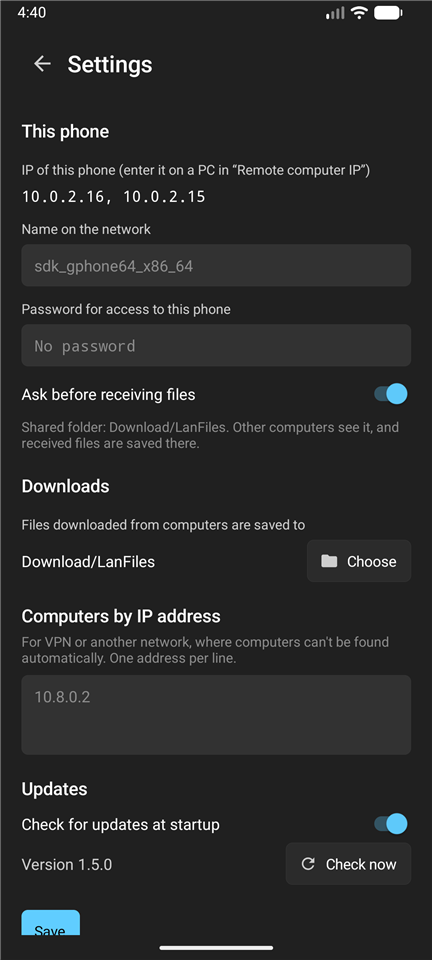

# LanFiles

File sharing between Windows PCs and Android phones on a local network.

Download `LanFiles.exe` (Windows) or `LanFiles.apk` (Android) from [Releases](https://github.com/idLorem/LanFiles/releases). To build from source, run `build.bat` (Windows) or `android\build.bat` (Android).

## Features

- Finds computers automatically.
- Send files by drag and drop.
- Browse shared folders.
- Password protection.
- Right-click a card to show it with a computer or smartphone icon.
- Ask before receiving.
- Progress and speed.
- Safe transfers.
- Runs in the tray and can start with Windows.
- Updates itself from GitHub releases.
- English and Russian interface.

## Android

- Finds computers on Wi-Fi and works with Windows LanFiles.
- Browse, download and upload files, create folders.
- Add a computer by IP for VPN or another network.
- Favorite computers: their addresses are saved and checked again over VPN.
- Starred computers send files without asking. On a TV, hold OK on a card to star it.
- Choose the folder for downloads.
- Shows the IP of the phone in Settings.
- Updates itself from GitHub releases.
- Receives files only while the app is open.
- Works on Android TV: appears in the TV launcher and is controlled with the remote.

The IP of a Windows PC is shown in Settings → IP of this computer.

## Описание на русском

Обмен файлами между компьютерами с Windows и телефонами на Android в локальной сети.

Скачайте `LanFiles.exe` (Windows) или `LanFiles.apk` (Android) в разделе [Releases](https://github.com/idLorem/LanFiles/releases). Чтобы собрать из исходников, запустите `build.bat` (Windows) или `android\build.bat` (Android).

- Сам находит компьютеры.
- Отправка перетаскиванием.
- Просмотр общих папок.
- Защита паролем.
- Значок «Компьютер» или «Смартфон» для карточки (правый клик).
- Подтверждение приёма.
- Прогресс и скорость.
- Надёжная передача.
- Работает в трее и может запускаться вместе с Windows.
- Обновляется сам из релизов на GitHub.
- Интерфейс на английском и русском.

Android:

- Находит компьютеры в Wi-Fi и работает с LanFiles для Windows.
- Просмотр, скачивание и отправка файлов, создание папок.
- Добавление компьютера по IP для VPN или другой сети.
- Избранные компьютеры: их адреса сохраняются и проверяются через VPN.
- Компьютеры со звёздочкой отправляют файлы без вопроса. На ТВ звёздочка ставится долгим нажатием OK на карточке.
- Выбор папки для загрузок.
- IP телефона виден в настройках.
- Обновляется сам из релизов на GitHub.
- Принимает файлы, только пока приложение открыто.
- Работает на Android TV: значок в меню ТВ, управление пультом.

IP компьютера с Windows виден в «Настройки → IP этого компьютера».
